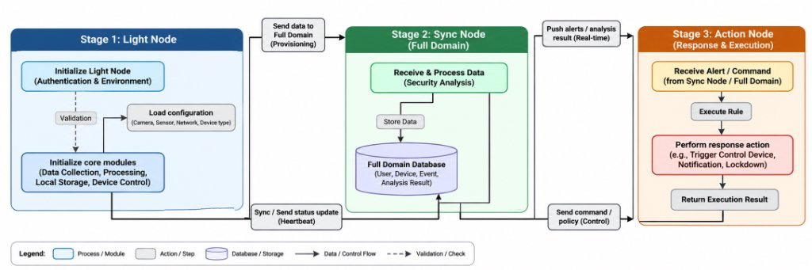

# Machine Learning in Anomaly Detection for Data Streams of Industrial IoT Systems

> **Graduation Thesis** — Faculty of Information Technology  
> An End-to-End Industrial IoT (IIoT) Condition Monitoring & Predictive Maintenance Platform applying Machine Learning models to detect anomalies and trigger automated safety interlocks in real-time.

---

## Problem Statement

In industrial manufacturing environments, continuous rotating machinery (specifically 3-phase AC induction motors) powers critical equipment such as pumps, fans, and compressors. Mechanical degradation (bearing wear, winding overheating, rotor lock) leads to catastrophic failures and severe downtime costs. This project builds a complete, real-time IIoT platform that monitors physical sensor streams, isolates multivariate anomalies with ML models, and actuates automatic protective interlocks.

---

## System Architecture: Three-Stage Node Architecture



### Architecture Breakdown & Data Flow

The system is organized into a formal **3-Stage Node Pipeline** representing an enterprise IIoT control loop:

#### 1. Stage 1: Light Node (IoT Edge Telemetry)
* **Role & Responsibility:** Edge-level data acquisition, physical sampling, and local telemetry pre-processing.
* **Implementation:** Built with **Python 3.11** (`simulator/main.py` & `simulator/inject_fault.py`) simulating an edge industrial microcontroller (such as an ESP32 or Raspberry Pi) mounted on a 3-Phase Induction Motor.
* **Mechanism:**
  * **Initialization & Validation:** Configures baseline device identity (`MOTOR_INDUCTION_01`), calibration parameters, and physical ratings (1450 RPM nominal speed, 15A full-load current).
  * **Core Telemetry Sampling:** Continuous 2 Hz (500ms) multi-channel sampling of 4 physical parameters:
    * Tri-axial vibration (X, Y, Z) derived from rotational angular frequency (omega = 2*pi*f) with natural Gaussian noise N(0, sigma^2).
    * Stator winding temperature (°C).
    * Phase current consumption (A).
    * Shaft rotational velocity (RPM).
  * **CLI Anomaly Injection:** On-demand induction of physical fault profiles (`spike`, `drift`, `jam`, `critical`) for model benchmarking.
  * **Outbound Transmission:** Emits serialized JSON sensor packets via full-duplex WebSocket (`sensor:data`) to Stage 2.

#### 2. Stage 2: Sync Node / Full Domain (Ingestion Gateway & Persistence)
* **Role & Responsibility:** High-throughput streaming ingestion, security analysis, time-series persistence, and dispatch.
* **Implementation:** Built with **Node.js (TypeScript)**, **Fastify**, **Socket.IO Hub**, and **Prisma ORM** (`backend/src/index.ts`).
* **Mechanism:**
  * **Receive & Process Data:** Ingests live telemetry streams from Stage 1 over WebSocket (`/ws` path) with sub-10ms latency.
  * **Time-Series Storage:** Persists sensor readings and fault metadata directly into a **SQLite** database (`prisma/dev.db`) using Prisma ORM (designed for seamless migration to PostgreSQL).
  * **Security & Anomaly Evaluation:** Tracks telemetry deviation scores and checks request payloads.
  * **Push Alerts & Broadcast:** Immediately broadcasts processed telemetry packets (`dashboard:update`) to Stage 3 and triggers emergency state updates when anomaly indices breach critical thresholds.

#### 3. Stage 3: Action Node (Response, SCADA Visualization & Safety Execution)
* **Role & Responsibility:** Real-time operator SCADA interface, diagnostic explainability, rule execution, and downstream emergency actuator control.
* **Implementation:** Built with **React 18**, **TypeScript**, **TailwindCSS v4**, **Recharts**, and **Lucide React** (`frontend/src/`).
* **Mechanism:**
  * **Live SCADA Monitoring:** Renders a clean industrial dashboard (White, Blue, Amber palette) displaying 4 KPI metric cards and dual-axis real-time line charts for vibration harmonics and thermal-electrical load correlation.
  * **Execute Rule & Automated Interlock:** Evaluates incoming anomaly scores. When `anomalyScore >= 0.85` (Critical Failure), the UI autonomously executes a safety interlock rule, preempting the normal dashboard and redirecting to the **Emergency Interlock View** (`EmergencyPage.tsx`).
  * **Perform Response Action:** Simulates a physical safety relay trip severing motor drive power, presents root-cause diagnostics, and displays telemetry snapshots at the failure instant.
  * **Bidirectional Downlink Control:** Provides an operator **"Acknowledge & Reset System"** button. Triggering this emits `system:reset_request` back to Stage 2, which commands Stage 1 (`simulator:reset`) to clear faults, restoring the motor to baseline healthy operation.

---

## Technology Stack & Implementation Mapping

| Stage / Component | Technologies & Tools | Specific Role in System |
|---|---|---|
| **Stage 1 (Light Node)** | **Python 3.11**, `python-socketio`, `requests`, `numpy` | Emulates edge microcontroller; samples physical vibration equations and injects synthetic faults via CLI. |
| **Stage 2 (Sync Node)** | **Node.js**, **Fastify**, **Prisma ORM**, **Socket.IO**, **SQLite** | Ingestion gateway; handles bidirectional WebSocket routing and time-series historical data persistence. |
| **Stage 3 (Action Node)** | **React 18**, **TypeScript**, **TailwindCSS v4**, **Recharts** | Operator SCADA UI; renders real-time waveforms and triggers automated emergency interlock page. |
| **AI Subsystem (Engine)** | **Python 3.11**, **FastAPI**, `scikit-learn`, `TensorFlow/PyTorch` | Multivariate anomaly scoring using Isolation Forest (transient spikes) and LSTM Autoencoder (temporal drift). |
| **Engineering Standards** | **GitHub Spec-Kit (SDD)**, **Matt Pocock Skills** | Spec-Driven Development via `.specify/constitution.md` and Architectural Decision Records (ADRs). |

---

## AI / ML Models

| # | Model | Target Layer | Task & Methodology |
|---|-------|-------------|---------------------|
| 1 | **Isolation Forest** | IoT Sensor Stream | Unsupervised tree-based outlier isolation; detects sudden vibration spikes and sensor disconnects in <5ms. |
| 2 | **LSTM Autoencoder** | IoT Sensor Stream | Deep recurrent reconstruction; models normal temporal dependencies. High reconstruction error flags thermal drift and bearing degradation. |
| 3 | **Traffic Anomaly Detector** | Gateway API | Evaluates request frequencies and metadata patterns to mitigate brute-force and DoS attempts. |
| 4 | **TF-IDF + Logistic Regression** | Gateway API | Lightweight NLP payload inspector to detect SQL Injection (`' OR 1=1`) and XSS attacks on control endpoints. |

---

## Fault Profiles & Ground Truth

| Fault Profile | Physical Sensor Channel | Signature Pattern | Industrial Meaning |
|---|---|---|---|
| **Bearing Scratch (`spike`)** | Vibration (X, Z) | Rapid instantaneous pulse > 5.5 mm/s | Roller element striking a raceway fissure |
| **Winding Overheat (`drift`)** | Stator Temperature | Steady +0.5°C/step cumulative rise | Thermal runaway, cooling fan failure, dry friction |
| **Mechanical Jam (`jam`)** | Current & RPM | Current > 25A, RPM collapses < 1000 | Rotor obstruction, seized impeller, heavy overload |
| **Catastrophic (`critical`)** | All Channels | Vibration > 10 mm/s, Temp > 95°C, Current > 30A | Multi-point structural failure triggering Emergency Interlock |

---

## Project Structure

```
iot-motor-monitoring/
├── .specify/                  # Spec-Driven Development (github/spec-kit)
│   ├── constitution.md        # Fundamental project constraints and safety rules
│   └── specs/                 # SPEC-001 Core Telemetry & Safety Interlock
├── frontend/                  # Stage 3: Action Node (React 18 + TailwindCSS)
│   └── src/
│       ├── components/        # EmergencyPage.tsx, SCADA cards, charts
│       ├── hooks/             # useWebSocket.ts (bidirectional streaming & reset)
│       ├── types/             # iot.ts (Data contracts)
│       └── App.tsx            # Main SCADA operational dashboard
├── backend/                   # Stage 2: Sync Node (Fastify + Prisma Gateway)
│   ├── prisma/
│   │   ├── schema.prisma      # SQLite schema: Device, SensorReading, Alert
│   │   └── dev.db             # Local time-series database
│   └── src/
│       ├── index.ts           # Fastify server & Socket.IO WebSocket Hub
│       └── seed.ts            # Seed script for motor assets
├── simulator/                 # Stage 1: Light Node (Python IoT Edge)
│   ├── main.py                # Mathematical physics engine & 2 Hz packet stream
│   ├── inject_fault.py        # CLI fault injection tool for live demos
│   └── requirements.txt       # Python client dependencies
└── docs/                      # Architectural Decision Records & diagrams
    ├── images/                # stage_architecture.jpg & system diagrams
    ├── adr/decisions.md       # ADR-001 through ADR-004
    └── agents/project.md      # Domain glossary and agent configurations
```

---

## Quick Start & Verification

### Prerequisites
* Node.js v20+ / v22+
* Python 3.11+
* Git

### 1. Start Ingestion Gateway (Stage 2)
```powershell
cd backend
npm install
npm run db:push
npm run dev
# Server active at http://localhost:3001 (WebSocket hub: ws://localhost:3001/ws)
```

### 2. Start SCADA Web Dashboard (Stage 3)
```powershell
cd frontend
npm install
npm run dev
# Open browser at http://localhost:5173
```

### 3. Start IoT Edge Telemetry Node (Stage 1)
```powershell
cd simulator
pip install -r requirements.txt
python main.py
# Streaming starts at 2 packets/second
```

### 4. Trigger Live Anomaly Injection (Evaluation Demo)
Open an additional terminal to dispatch fault commands into the running loop:
```powershell
cd simulator

# Trigger mechanical bearing spike
python inject_fault.py --type spike

# Trigger gradual overheating drift
python inject_fault.py --type drift

# Trigger catastrophic multi-point failure (trips Emergency Interlock Page on UI)
python inject_fault.py --type critical
```

---

## Next To-Do List (Upcoming Milestones)

- [ ] **1. Standalone AI Engine Deployment (`ai-engine/`):**
  - Build Python 3.11 + FastAPI microservice listening on port 8000.
  - Implement `/api/predict` endpoint receiving telemetry windows from Node.js Gateway.
- [ ] **2. Offline Model Training & Serialization:**
  - Write `ai-engine/training/train.py` to train **Isolation Forest** (on statistical features) and **LSTM Autoencoder** (on normal temporal sequences).
  - Pre-train using benchmark normal telemetry and serialize into `models/isolation_forest.joblib` and `models/lstm_autoencoder.pt`.
- [ ] **3. Gateway-to-AI Integration:**
  - Connect Fastify backend to forward sliding windows of sensor readings to the AI Engine for live inference.
  - Return dynamic Anomaly Score & Reconstruction Error to replace mock scores.
- [ ] **4. Web Audit & Alert History Interface:**
  - Build a historical log table on the React dashboard reading stored incident alerts from SQLite.
- [ ] **5. Quantitative Evaluation Benchmark:**
  - Generate Confusion Matrix, Precision, Recall, and F1-Score reports comparing Isolation Forest vs. LSTM Autoencoder for thesis documentation.

---

## License

MIT License — Academic Graduation Thesis
