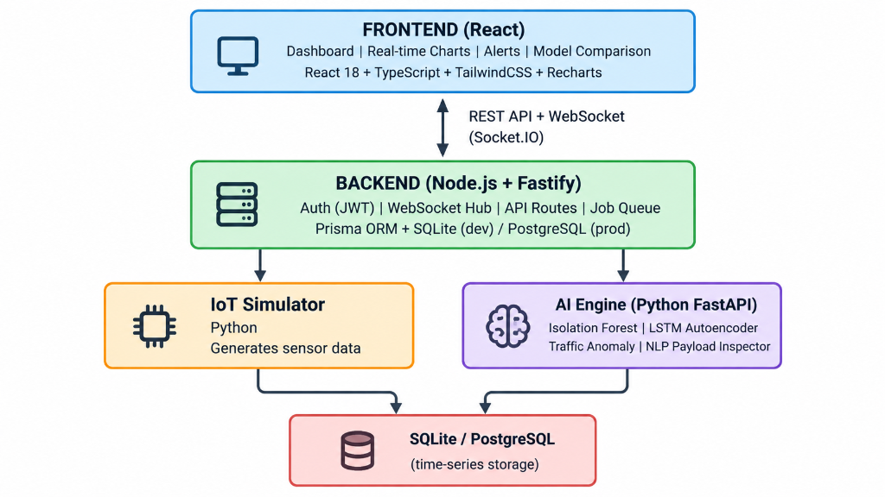

# Machine Learning in Anomaly Detection for Data Streams of Industrial IoT Systems

> **Graduation Thesis** — Faculty of Information Technology  
> A real-time IIoT monitoring platform that applies machine learning models to detect anomalies in industrial motor sensor data streams.

---

## Problem Statement

In industrial environments (factories, production lines), machinery continuously generates time-series sensor data. When equipment begins to degrade or malfunction, these metrics deviate from learned normal patterns. Early detection of such anomalies enables **predictive maintenance**, preventing costly breakdowns before they occur.

## System Architecture



## AI / ML Models

| # | Model | Target Layer | Task |
|---|-------|-------------|------|
| 1 | **Isolation Forest** | IoT Sensor | Detects sudden spikes & point outliers |
| 2 | **LSTM Autoencoder** | IoT Sensor | Detects slow drift faults via reconstruction error |
| 3 | **Isolation Forest** (on request logs) | Web Security | Detects DDoS / brute-force attack patterns |
| 4 | **TF-IDF + Logistic Regression** | Web Security | Detects SQL Injection & XSS in API payloads |

## Fault Types Detected

| Fault | Affected Sensor | Anomaly Pattern | Real-world Meaning |
|-------|----------------|-----------------|-------------------|
| Bearing Fault | Vibration (X/Y/Z) | High-frequency spike, elevated kurtosis | Cracked/dry bearing → shaft seizure imminent |
| Shaft Misalignment | Vibration (3-axis) | Periodic amplitude increase at rotation frequency | Motor shaft not aligned with load |
| Overheating / Winding Fault | Temperature (PT100) | Slow upward drift, no recovery | Broken cooling fan or stator winding damage |
| Mechanical Jamming / Overcurrent | Current (CT sensor) | Current surges 2–3× rated value | Pump blocked, motor straining against load |

## Tech Stack

| Layer | Technology |
|-------|-----------|
| Frontend | React 18, TypeScript, TailwindCSS v4, Recharts, Socket.IO-client, Zustand |
| Backend | Node.js, Fastify, Prisma ORM, SQLite, Socket.IO |
| AI Engine | Python 3.11, FastAPI, scikit-learn, TensorFlow/Keras, Pandas |
| Simulator | Python 3.11 (generates synthetic motor sensor data with injectable faults) |
| DevOps | Docker Compose |

## Project Structure

```
iot-motor-monitoring/
├── frontend/          # React 18 + TailwindCSS dashboard
│   └── src/
│       ├── components/  (dashboard, charts, alerts, security)
│       ├── hooks/        useWebSocket | useAnomalyStream | useSensorChart | useAIComparison
│       ├── pages/
│       ├── store/        Zustand global state
│       └── types/
├── backend/           # Fastify + Prisma + WebSocket Hub
│   ├── src/
│   │   ├── routes/
│   │   ├── plugins/
│   │   ├── middleware/  (AI-powered security middleware)
│   │   └── websocket/
│   └── prisma/
│       └── schema.prisma
├── ai-engine/         # Python FastAPI microservice
│   ├── models/        (isolation_forest, lstm_autoencoder, nlp_classifier)
│   ├── training/
│   └── api/
├── simulator/         # IoT data generator with fault injection
└── docs/
    ├── agents/        project.md  ← domain config for AI agents
    └── adr/           decisions.md ← Architecture Decision Records
```

## Quick Start

```bash
# Run all services with Docker
docker compose up --build

# Or run individually (dev mode)
cd simulator  && python main.py
cd backend    && pnpm dev
cd ai-engine  && uvicorn main:app --reload --port 8000
cd frontend   && pnpm dev
```

## Evaluation Metrics

| Metric | Description |
|--------|-------------|
| Precision | Ratio of true anomaly alerts out of all raised alerts |
| Recall | Ratio of detected anomalies out of all actual faults |
| F1-Score | Harmonic mean of Precision and Recall |
| Inference Latency | Time (ms) from sensor reading to anomaly verdict |

## License

MIT
