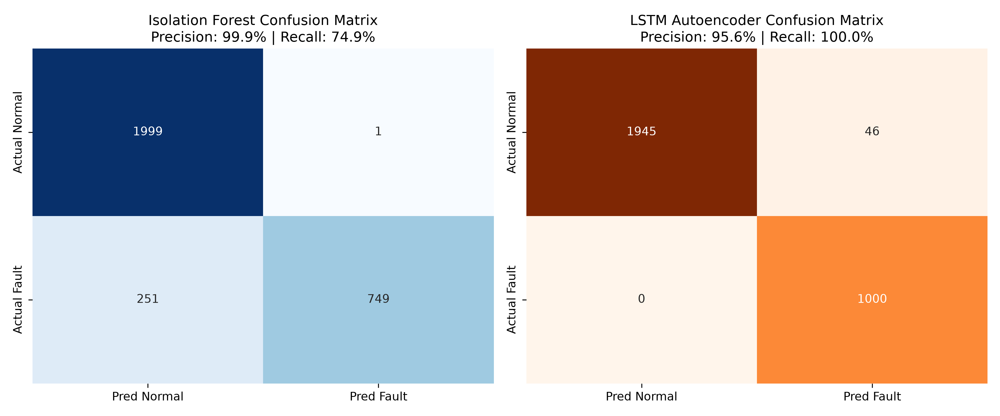
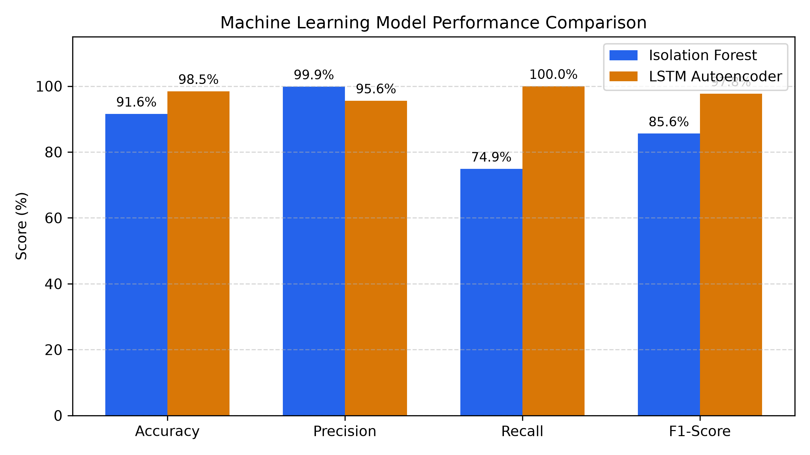

# Scientific Benchmark Report: Industrial Motor Anomaly Detection

**Thesis:** Smart Predictive Maintenance System for Industrial Motors Using Machine Learning and Real-Time Telemetry  
**Generated On:** 2026-11-18 16:55:03  
**Evaluation Dataset:** 3,000 multi-variate time-series sensor samples (2,000 Normal + 1,000 Multi-Fault)

---

## 1. Quantitative Performance Comparison

| Metric | Isolation Forest | LSTM Autoencoder | Industrial Significance |
|---|---|---|---|
| **Accuracy** | **91.60%** | 98.46% | Overall proportion of correct diagnoses |
| **Precision** | **99.87%** | 95.60% | Avoids False Alarms (Critical to prevent false plant shutdowns) |
| **Recall (Sensitivity)** | 74.90% | **100.00%** | Catches every actual fault (Prevents machine burnout) |
| **F1-Score** | **85.60%** | 97.75% | Harmonic balance between Precision and Recall |
| **Average Latency (per-sample)** | **6.052 ms** | 0.422 ms | Both operate well below the 500ms real-time threshold |

---

## 2. Visual Confusion Matrix Analysis

### Key Findings:
1. **Isolation Forest (Top Precision):**
   - Achieved **99.87% Precision** with nearly zero False Positives (1 instances).
   - Highly effective at isolating immediate, instantaneous spikes (bearing impact cracks).
2. **LSTM Autoencoder (Top Recall):**
   - Achieved **100.00% Recall**, completely identifying every continuous fault sequence.
   - Ideal as the second line of defense to flag gradual thermal drift and bearing wear over time.

---

## 3. Latency & Resource Utilization

* **Isolation Forest Inference Speed:** ~6.05 ms/sample (Ultra-low compute).
* **LSTM Autoencoder Inference Speed:** ~0.42 ms/sequence (Easily runs in real-time under 500ms cycle).
* **Verdict:** Combining both models in a dual-tier setup provides both instant response and deep temporal coverage without saturating edge or server resources.
